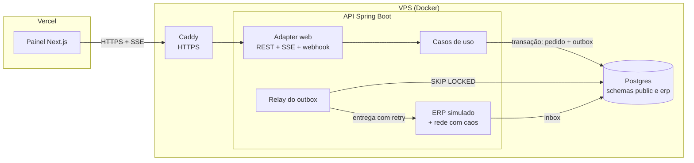

# Pedido Certo

[](https://github.com/JoaoOliveira07/pedido-certo/actions/workflows/ci.yml)

**Cada pedido chega ao ERP uma vez só, mesmo quando a rede perde, repete ou atrasa mensagens.**

Demonstração ao vivo: **[pedidos.jopes.com.br](https://pedidos.jopes.com.br)** · API: `api-pedidos.jopes.com.br`

Uma loja B2B recebe pedidos, confirma o pagamento por PIX e entrega cada pedido pago a um ERP do outro lado de uma rede instável. No painel você controla essa rede (mensagens que não chegam, respostas que se perdem, entregas em dobro) e acompanha cada pedido até o ERP. O número que importa fica sempre em zero: pedidos duplicados no ERP.

É a versão aberta e reduzida de um problema que eu resolvo no trabalho, integrando um ERP on-premise a uma plataforma na nuvem. Nenhum código daquele projeto está aqui.

## O problema

Integrar dois sistemas por rede tem três falhas clássicas, e cada uma pede uma defesa:

| O que dá errado | O que aconteceria sem cuidado | A defesa neste projeto |
|---|---|---|
| O cliente reenvia a criação do pedido (clique duplo, timeout, retry automático) | Dois pedidos iguais | `Idempotency-Key` obrigatória em `POST /api/orders` ([ADR 0004](docs/adr/0004-idempotency-key.md)) |
| O processo cai entre "marcar como pago" e "avisar o ERP" | Pedido pago que nunca chega ao ERP | Outbox transacional: status e mensagem gravados na mesma transação ([ADR 0002](docs/adr/0002-outbox-e-consumidor-idempotente.md)) |
| O ERP processa, mas a resposta se perde, e a loja reenvia | Pedido duplicado no ERP | Consumidor idempotente: o ERP guarda o id de cada mensagem e descarta repetições |

Entrega "exatamente uma vez" não existe na rede. O que existe é **entrega pelo menos uma vez + processamento idempotente**, que produz o mesmo efeito. O projeto inteiro é a demonstração disso.

## Arquitetura



O backend segue **arquitetura hexagonal** ([ADR 0001](docs/adr/0001-arquitetura-hexagonal.md)), e as regras são verificadas no build com ArchUnit:

```
api/src/main/java/br/com/jopes/pedidocerto
├── domain/          Java puro: Pedido, transições de status, política de retry
├── application/
│   ├── port/in/     casos de uso (o que a aplicação oferece)
│   ├── port/out/    o que ela precisa do mundo (repositório, outbox, ERP...)
│   └── service/     implementação dos casos de uso
├── adapter/
│   ├── in/web/      REST, webhook do PIX com HMAC, SSE, Problem Details
│   ├── in/scheduling/  dispara o relay do outbox
│   ├── out/persistence/  JDBC + SQL explícito (outbox com SKIP LOCKED)
│   ├── out/erp/     ERP simulado (consumidor idempotente) e a rede com caos
│   └── out/chaos/   configuração de caos em memória
└── config/          montagem dos beans e propriedades
```

Mais detalhes, com o diagrama de sequência de um pedido: [docs/architecture.md](docs/architecture.md).

## Decisões registradas

| ADR | Decisão |
|---|---|
| [0001](docs/adr/0001-arquitetura-hexagonal.md) | Arquitetura hexagonal, verificada com ArchUnit |
| [0002](docs/adr/0002-outbox-e-consumidor-idempotente.md) | Outbox transacional + consumidor idempotente em vez de "exactly once" |
| [0003](docs/adr/0003-fila-no-postgres.md) | Fila no próprio Postgres (`FOR UPDATE SKIP LOCKED`) em vez de SQS ou Kafka |
| [0004](docs/adr/0004-idempotency-key.md) | `Idempotency-Key` obrigatória, com hash do corpo |
| [0005](docs/adr/0005-erp-simulado-no-mesmo-processo.md) | ERP simulado no mesmo processo, em outro schema |
| [0006](docs/adr/0006-jdbc-em-vez-de-jpa.md) | Spring JDBC (`JdbcClient`) com SQL explícito em vez de JPA |
| [0007](docs/adr/0007-hospedagem-vps-e-vercel.md) | API em VPS com Docker e Caddy; painel na Vercel |

## Rodando localmente

Precisa só de Docker.

```bash
docker compose up --build
```

- Painel: http://localhost:3000
- API: http://localhost:8080/api/orders
- Saúde: http://localhost:8080/actuator/health

Testando na mão:

```bash
# cria um pedido (rode duas vezes: a segunda devolve o mesmo pedido, com Idempotent-Replayed: true)
curl -i localhost:8080/api/orders \
  -H 'Content-Type: application/json' -H 'Idempotency-Key: teste-0001' \
  -d '{"customerName":"Mercado Teste","items":[{"sku":"LIN-5KG","description":"Linguiça 5 kg","quantity":2,"unitPriceCents":8990}]}'

# simula o PSP pagando o PIX (troque pelo id devolvido acima)
curl -X POST localhost:8080/api/demo/orders/<id>/pay

# piora a rede
curl -X PUT localhost:8080/api/demo/chaos -H 'Content-Type: application/json' \
  -d '{"failureRate":0.5,"ackLossRate":0.4,"duplicateRate":0.6,"latencyMs":300}'
```

## Testes

| Camada | O que cobre | Como roda |
|---|---|---|
| Domínio | Transições do pedido, idempotência das operações, backoff | `OrderTest`, `RetryPolicyTest`, sem Spring |
| Aplicação | O fluxo inteiro com a rede falhando de propósito: ack perdido, timeout, DLQ, lease expirado | `OrderFlowTest`, com adapters em memória, em milissegundos |
| Arquitetura | Domínio sem framework, casos de uso sem detalhes técnicos, adapters independentes | `ArchitectureTest` (ArchUnit) |
| Integração | HTTP, transações, SQL, restrições do banco e 8 requisições simultâneas com a mesma chave | `OrderFlowIT`, com Postgres real via Testcontainers |
| Painel | Cliente da API (Idempotency-Key, Problem Details) e formatação | Vitest |

```bash
cd api && mvn verify          # unitários + integração (precisa de Docker)
cd web && npm ci && npm test  # painel
```

## Stack

**API:** Java 21, Spring Boot 3.5, Spring JDBC, Flyway, PostgreSQL 17, Micrometer/Prometheus, JUnit 5, ArchUnit, Testcontainers.
**Painel:** Next.js 16 (exportação estática), React 19, TypeScript estrito, CSS sem framework, Vitest.
**Infra:** Docker, Caddy, VPS Ubuntu, GitHub Actions, GitHub Container Registry, Vercel.

## Deploy

Push na `main` → CI → imagem da API no GHCR → a VPS baixa e reinicia. A Vercel publica o painel em paralelo. Passo a passo, incluindo DNS na Hostinger: [docs/deploy.md](docs/deploy.md).

## O que ficou de fora, de propósito

- **Várias instâncias da API.** O relay já suporta (é para isso que serve o `SKIP LOCKED`), mas o SSE e o caos vivem em memória. O caminho está descrito no [ADR 0005](docs/adr/0005-erp-simulado-no-mesmo-processo.md).
- **Autenticação.** A demo é pública por definição. Num sistema real, a criação de pedidos exigiria um token do cliente B2B.
- **Um ERP de verdade.** O adapter `ErpGateway` é o ponto de troca: um cliente HTTP ou de fila implementa a mesma porta.

## Licença

[MIT](LICENSE). Feito por [João Paulo Oliveira](https://www.jopes.com.br).
