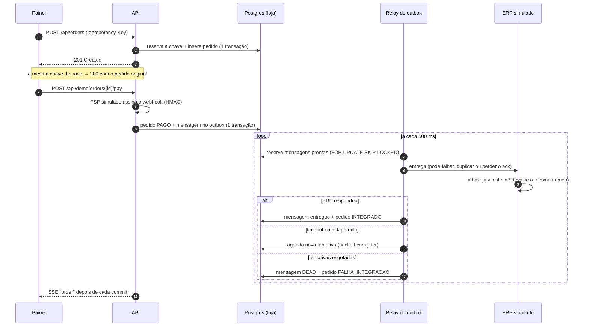
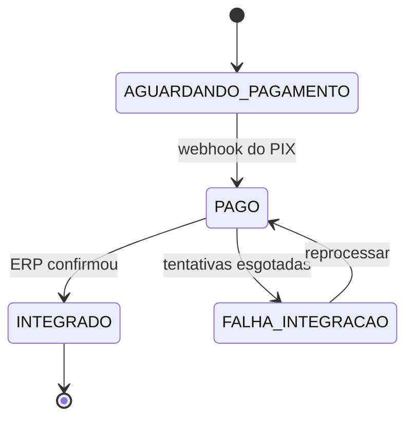

# Arquitetura

## A vida de um pedido

## Estados do pedido

As transições ficam no agregado `Order`. As operações que sistemas externos podem repetir (`markPaid`, `markIntegrated`) são idempotentes: uma repetição devolve `false` em vez de lançar erro.

## Onde cada garantia mora

| Garantia | Código | Teste que prova |
|---|---|---|
| Uma chave, um pedido, mesmo em paralelo | `JdbcIdempotencyStore.tryReserve` (`on conflict do nothing` sobre a PK) | `OrderFlowIT.concurrentRequestsWithTheSameKeyCreateASingleOrder` |
| Não existe pedido pago sem mensagem | `ConfirmPaymentService.confirm` (`@Transactional`) | `OrderFlowTest.repeatedWebhookWritesASingleOutboxMessage` |
| Duas instâncias não pegam a mesma mensagem | `JdbcOutboxStore.claimDue` (`SKIP LOCKED` + lease) | `OrderFlowTest.leaseExpiryRedeliversAMessageWhoseResultWasNeverRecorded` |
| Reentrega não duplica no ERP | `SimulatedErp.receive` (inbox + `unique(order_id)`) | `OrderFlowIT.duplicatedDeliveriesAndLostAcksNeverDuplicateTheErpOrder` |
| Falha permanente não some em silêncio | `DeliveryOutcomes.failed` (DLQ + status) | `OrderFlowIT.exhaustedDeliveriesGoToTheDeadLetterQueueAndCanBeRetried` |
| Webhook não pode ser forjado | `PixSignature` (HMAC-SHA256, comparação em tempo constante) | `OrderFlowIT.webhookWithAnInvalidSignatureIsRejected` |

## Transações

- **Criação e pagamento:** uma transação cada, curta.
- **Entrega ao ERP:** de propósito **sem** transação em volta da chamada de rede. A reserva da mensagem é um `UPDATE … RETURNING` em autocommit; o resultado é gravado depois, em outra transação curta (`DeliveryOutcomes`). Segurar uma conexão do pool enquanto se espera a rede é a forma mais comum de derrubar uma API sob carga.
- **ERP simulado:** `REQUIRES_NEW`, porque representa outro sistema, que confirma por conta própria.
- **Eventos para o painel:** publicados em `afterCommit`, então ninguém vê um estado que ainda pode sofrer rollback.

## Observabilidade

- `GET /actuator/health/readiness` para o deploy e o healthcheck do Docker.
- `GET /actuator/prometheus` com métricas da JVM, do pool e do HTTP (bloqueado no Caddy, acessível só pela rede interna).
- Linha do tempo por pedido (`order_timeline`), que é o que o painel mostra: cada tentativa, falha e duplicata descartada, com o motivo.
